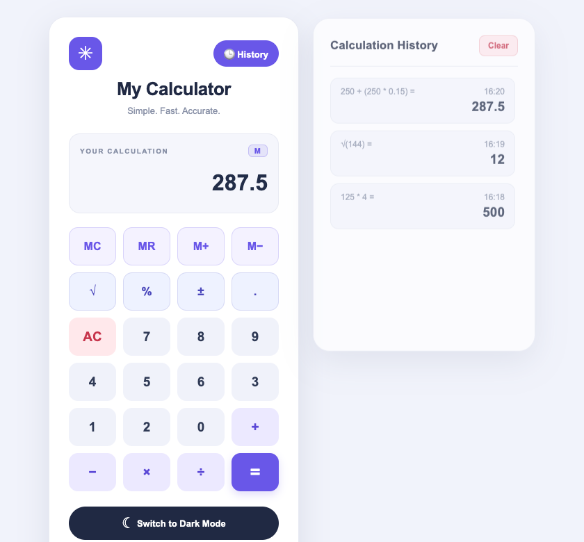
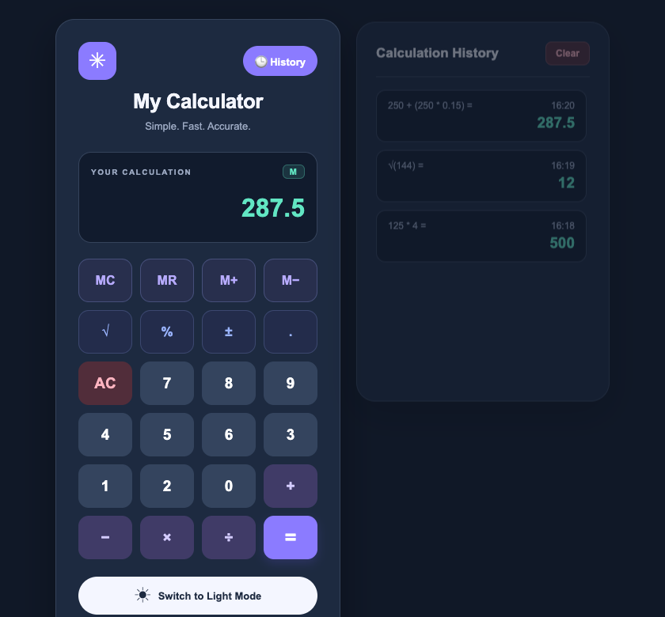

# My Calculator

A simple calculator built using HTML, CSS and JavaScript.

## Features

- Addition
- Subtraction
- Multiplication
- Division
- Clear the display
- **New Advanced Feature: Standard Memory Registers**
  - **MC (Memory Clear)**: Resets stored memory value back to zero.
  - **MR (Memory Recall)**: Loads stored memory value into the main display.
  - **M+ (Memory Add)**: Adds current display value to stored memory.
  - **M- (Memory Subtract)**: Subtracts current display value from stored memory.
- **New Advanced Feature: Advanced Math Calculations**
  - **Square Root (√)**: Instant square root calculation of display value.
  - **Percentage (%)**: Calculates percentage / converts value to percentage.
  - **Sign Toggle (±)**: Toggles current value between positive and negative.
- **New Advanced Feature: Interactive Calculation History Side Panel**
  - **Calculation Logging**: Automatically logs expressions and results upon evaluation.
  - **Interactive Recall**: Click any history entry to immediately restore its result to the display.
  - **Panel Drawer**: Accessible via the "🕒 History" header button with smooth slide toggle and "Clear" capability.

## Screenshots

### Light Mode (with Active Memory & History Panel)

### Dark Mode (with Active Memory & History Panel)

## Technologies Used

- HTML5
- CSS3 (Vanilla CSS with CSS Grid & Custom Properties)
- JavaScript (ES6+)

## How to Run

Open the `index.html` file in any modern web browser or serve it locally.
